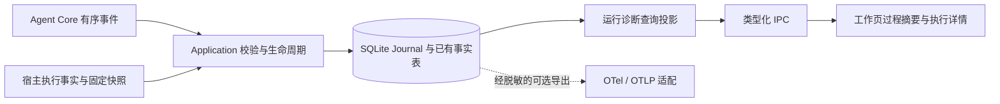

# 智能体执行追踪调研：AgentScope Studio、AgentScope 2.0 与算台

> 后续承接：2026-10-16 用户已接受本文建议并要求 GPT-6 Luna 开发卡，见 [AT 唯一任务板](../development/tasks-execution-tracing.md)、[实施契约](../development/execution-tracing-contracts.md)、[ADR-0050](../adr/0050-run-execution-diagnostics.md)与[目标交接](../development/execution-tracing-coding-prompts.md)。以下保留调研时点快照；技术细化仍 Proposed，产品代码未开工。
>
> 2026-10-16。状态：研究与建议，尚未批准为产品范围或实施契约。本轮不修改运行协议、数据库、界面与各任务板状态。
>
> 算台基线：`0bb1b13ff7b7fbfb1887893f7f9da9066a163e25`，本地分支 `codex/agent-execution-tracing-analysis`。
> Studio 基线：`20e7638273d3726732eb317b440bfa34e6694e17`，路径 `/Users/kevin/Dev4AI/agentscope-studio`。
> AgentScope 基线：`976e2ffc9c28869282bbcdde9a2661c48147ff3b`，路径 `/Users/kevin/Dev4AI/agentscope`。
>
> 方法：静态阅读三个仓库的源码、协议、相关测试与文档，并核对官方维护公告。没有启动参考应用、执行参考仓库测试或调用真实模型；下面的“已有实现”指源码中存在相应路径，不代表本轮运行验收通过。

## 1. 结论

可以借鉴，而且适合在算台现有基础上建设。建议组合采用 **AgentScope 2.0 的实时事件与生命周期设计、Studio 的调用树与详情查询思路、算台自己的 SQLite Run Journal 和来源快照**。

算台已经具备执行记录、工具进度、参数/结果详情、过程旁白、失败/取消和历史回看。真正缺少的是每轮模型请求的独立记录、明确的调用层次与耗时口径，以及围绕固定版本进行比较和评测的闭环。仅增加一块日志面板不能补齐这些能力。

本次调研得到四个判断：

1. **优先建设算台原生的运行诊断。** 沿用现有 Core → Application → SQLite → IPC → Renderer，不需要替换 Agent 引擎，也不需要先增加 Python 服务、Redis 或浏览器服务端。
2. **实时呈现与性能追踪需要不同投影。** 用户需要知道正在做什么；调优需要知道哪轮请求、哪个工具、哪个修订导致耗时或失败。两者共享事实，展示层分别组织。
3. **Studio 与 2.0 不能按功能名称视为完全等价迁移。** Studio 的 Trace 查询与调用树有实际代码，但评测仍有占位；2.0 有事件流、tracing middleware 和服务恢复交接代码，当前 Web UI 路由未提供同等的独立 Trace 分析页。
4. **追踪为“进化”提供证据，不自动产生进化。** 后续还需要失败样本、评价标准、固定输入与版本、回归对比和人类确认。不能由一次 Run 失败直接触发提示词、专家、Skill 或长期记忆的自动改写。

Studio 的本地 README 与[官方公告](https://github.com/agentscope-ai/agentscope-studio#archive-notice)均说明独立维护停止、后续能力转向 AgentScope 2.0。因此把 Studio 当实现参考更合适，长期产品依赖应另行评估。这里没有把 2.0 的全部产品能力纳入算台范围。

## 2. 两个参考项目究竟实现了什么

| 能力 | Studio 本地版本 | AgentScope 2.0 本地版本 | 对算台的价值 |
| --- | --- | --- | --- |
| 实时过程 | 消息/交互走 Socket.IO；Span 到达后另行推送 | 类型化 Event 流，模型、文本、工具调用与工具结果分别有生命周期；服务通过 SSE 提供 | 优先参考 2.0，补模型调用与结果的准确边界 |
| 调用追踪 | OTLP 接收、SQLite Span 存储、Trace 列表、调用树、属性与输入输出详情 | `TracingMiddleware` 包装 reply、model call、acting，创建 OTel Span | 前者参考查询与展示，后者参考埋点位置 |
| 耗时 | Trace 总时长、Span 起止时间与耗时数字 | Span 耗时、消息/内容块时间、界面耗时与用量提示 | 可据此扩展算台耗时诊断；完整瀑布图是本报告的建议增量 |
| 用量 | 模型调用次数、输入/输出 token 与按模型聚合 | 模型结束事件携带用量，消息层跨轮累计；tracing 也提取用量 | 算台已有 Provider 解析，应先接通持久化 |
| 历史与实时交接 | Run 房间加载历史 Span、接收增量并按 Span ID 合并；Trace 页面默认轮询 | 持久消息检查点、有限事件重放日志、先订阅再重放、按日志 entry ID 消除交接重复 | 借鉴交接协议与反例测试；保留算台持久 Journal |
| 专用工具呈现 | 通用输入/输出查看 | 连续工具分组，调用/结果按 ID 配对，有读写、终端、Diff 等专用 renderer | 借鉴渐进披露；按算台工具语义选择，不照搬编码工具 |
| 评测与对比 | Evaluation Context 使用演示数据；部分详情/比较页为占位 | 当前 `src/agentscope` 和 Web UI 路由中未发现完整独立评测产品入口；历史 changelog 提到过评测 | 两者都不能直接认定为可接入的调优闭环 |
| 自动优化 | 本次查阅未见从 trace 到自动修改 Agent 的闭环 | middleware 提供扩展点，但不等于已经具备适合算台的自动优化闭环 | 必须另行设计评价与变更治理 |

“完整瀑布图”不能算作本地 Studio 已实现能力：两个 Trace 详情实现均主要是父子树、耗时文本与属性区，未发现按统一时间轴绘制起点和宽度的瀑布视图。

### 2.1 Studio：采集后的查询与可视化

其主要链路为：外部 SDK/应用产生 Span → HTTP `/v1/traces` 或 gRPC → `SpanProcessor` → `SpanDao` / SQLite → Socket.IO 或 tRPC 查询 → Trace 页面。

- **入口与归一化**：HTTP 入口处理 protobuf/JSON 与压缩载荷；gRPC 入口处理 Export 请求。Processor 解码 ID、纳秒时间、属性、事件与 links，并转换部分旧版 AgentScope 字段。对应源码为 [OTLP HTTP 入口](https://github.com/agentscope-ai/agentscope-studio/blob/20e7638273d3726732eb317b440bfa34e6694e17/packages/server/src/otel/router.ts)、[Processor](https://github.com/agentscope-ai/agentscope-studio/blob/20e7638273d3726732eb317b440bfa34e6694e17/packages/server/src/otel/processor.ts)。这是接收器，不能自动观测没有埋点的任意脚本内部过程。
- **存储与查询**：`SpanTable` 保存完整属性，同时提取 model、operation、token、status、latency 等索引列；DAO 按 traceId 聚合范围、状态与用量，再提供分页和筛选。参考 [Span 模型](https://github.com/agentscope-ai/agentscope-studio/blob/20e7638273d3726732eb317b440bfa34e6694e17/packages/server/src/models/Trace.ts)与 [DAO](https://github.com/agentscope-ai/agentscope-studio/blob/20e7638273d3726732eb317b440bfa34e6694e17/packages/server/src/dao/Trace.ts)。
- **详情投影**：以 `spanId` 建 Map，再用 `parentSpanId` 组树；选中节点查看模型消息、函数输入输出与全部属性。参考 [TraceDetailPage](https://github.com/agentscope-ai/agentscope-studio/blob/20e7638273d3726732eb317b440bfa34e6694e17/packages/client/src/pages/TracePage/TraceDetailPage/index.tsx)。
- **实时边界**：Processor 校验要求 Span 有结束时间，界面接收到的是已上报的 Span。它和“请求刚开始便出现运行状态”是不同能力。不能用完成后上报替代算台当前的即时进度。
- **评测边界**：[EvaluationListRoomContext](https://github.com/agentscope-ai/agentscope-studio/blob/20e7638273d3726732eb317b440bfa34e6694e17/packages/client/src/context/EvaluationListRoomContext.tsx)明确使用 demo data 并保留获取服务数据的 TODO；`TaskComparisonPage` 只有占位内容，评测文档也写着待更新。

### 2.2 AgentScope 2.0：实时事件与 tracing 两条路径

2.0 的核心借鉴点比“把 Studio 搬进主仓库”更具体：

**第一条路径服务实时交互。** [事件协议](https://github.com/agentscope-ai/agentscope/blob/976e2ffc9c28869282bbcdde9a2661c48147ff3b/src/agentscope/event/_event.py)显式定义 `MODEL_CALL_START/END`、文本/数据块增量、工具调用增量、工具结果开始/增量/结束、Reply 结束及中断等。`Agent._reasoning_impl` 在准备模型输入前发出开始事件，在完整响应后发出用量和结束原因；[消息模型的 append_event](https://github.com/agentscope-ai/agentscope/blob/976e2ffc9c28869282bbcdde9a2661c48147ff3b/src/agentscope/message/_base.py)将事件还原为内容块和累计用量。

**第二条路径服务调用诊断。** [TracingMiddleware](https://github.com/agentscope-ai/agentscope/blob/976e2ffc9c28869282bbcdde9a2661c48147ff3b/src/agentscope/middleware/_tracing/_trace.py)在 `on_reply`、`on_model_call`、`on_acting` 周围创建 Span，并在正常完成、异常和生成器关闭时收口。未配置实际 OTel SDK Provider 时走透传路径；存在 middleware 不代表默认应用已配置 exporter，也不代表自动有诊断后台。

其中有一个值得保留为回归反例的细节：reply/acting 的父级 OTel context 只在推进生成器的同一次步骤里 attach/detach，不跨 `yield` 持有 token，避免其他异步任务关闭生成器时发生上下文脱离错误。[tracing_test.py](https://github.com/agentscope-ai/agentscope/blob/976e2ffc9c28869282bbcdde9a2661c48147ff3b/tests/tracing_test.py)有对应测试。算台应借鉴其生命周期纪律，具体实现仍遵循 TypeScript 的现有显式 Run 上下文，不引入全局业务状态。

**服务层解决历史与实时的交接。** [publish_session_event](https://github.com/agentscope-ai/agentscope/blob/976e2ffc9c28869282bbcdde9a2661c48147ff3b/src/agentscope/app/_bus_ops.py)先追加 replay log，再广播；[SSE 路由](https://github.com/agentscope-ai/agentscope/blob/976e2ffc9c28869282bbcdde9a2661c48147ff3b/src/agentscope/app/_router/_session.py)先建立订阅，再读检查点后的历史，最后消除交接处的重复 entry。[SessionEventStreamTest](https://github.com/agentscope-ai/agentscope/blob/976e2ffc9c28869282bbcdde9a2661c48147ff3b/tests/session_event_stream_test.py)构造事件恰好落在 replay/live 交界处的反例。

这套 replay log 是传输缓冲：`SESSION_REPLAY_MAX_LEN = 1000`；ChatService 在持久化消息/AgentState、更新 checkpoint 后裁剪日志。它不能替代算台长期保留逐轮模型和工具事实的 Journal。Web UI 的 `useMessages.ts` 先读历史消息和 cursor，再建立 SSE，增量应用委托外部 npm SDK；该 TypeScript reducer 的完整实现不在本轮本地源码审查范围内。

## 3. 算台现状：基础已具备，关键数据仍缺一段

| 层次 | 当前源码事实 | 尚缺能力与影响 |
| --- | --- | --- |
| 事件协议 | `id / runId / sequence / createdAt`，消息、工具进度与 Run 终态齐全 | 没有逐轮 model call 生命周期、独立 modelCallId 或通用父子关系 |
| Provider | `ModelStreamChunk.done` 可携带 finishReason、真实 usage、providerRequestId、providerResponseId、responseModel | 主 Core 循环未把 usage 转成共享持久事件；部分请求标识只进入 unknown-tool 诊断 |
| Run Journal | SQLite 保存有序事件；终态与 runs 状态事务更新；Application 先落库再广播 | 能重建消息与工具过程，但无法重建未记录的每轮模型指标 |
| 工具呈现 | `deriveToolActivity` 按 toolCallId 合并状态，详情展示输入/结果/错误；Skill 结构化失败不会被外层 completed 掩盖 | 当前投影没有工具起止/耗时字段，缺模型轮次与工具之间的明确关联 |
| 准备与清理 | RunService 装配材料/记忆/Skill/MCP；Lifecycle 处理审计、资源清理、取消裁决与成果登记 | 这些宿主阶段尚未作为统一诊断时间线呈现；不能把全部非工具耗时归给 LLM |
| 版本与来源 | 已有 RunContextSnapshot、RunSkillBinding、实际材料读取、成果输入关系和记忆请求审计 | 事实分散，需要通过 runId 联查，形成诊断详情；不应再复制一份正文 |
| 记忆请求审计 | `withRunMemoryAudit` 固定首个请求的 requestHash 与 dispatch-attempted | 它是派发审计门，既非逐轮 trace，也不是网络送达/服务端处理的证明 |
| 脚本执行 | 已有 executionId、toolCallId、bindingId、开始/结束、超时/取消和输出校验事实 | 需要关联到同一调用树；Python/CLI 内部阶段需要显式埋点才能细分 |

直接依据：

- [共享事件协议](../../packages/agent-protocol/src/index.ts)第 23–83 行；[Core 类型](../../packages/agent-core/src/types.ts)中的 `ModelStreamChunk`；[Core 主循环](../../packages/agent-core/src/agent-engine.ts)第 131–210 行。
- [Provider](../../packages/agent-core/src/openai-compatible-provider.ts)中的 usage 解析、请求构造与 done 输出。当前请求未显式加入 `stream_options.include_usage`；不同兼容服务是否返回用量需要按能力验证，不能承诺所有服务都有 token 数。
- [RunRepository](../../apps/desktop/src/main/persistence/run-repository.ts)、[RunEventLifecycle](../../apps/desktop/src/main/services/run-event-lifecycle.ts)、[记忆派发审计](../../apps/desktop/src/main/services/memory-dispatch-gate.ts)。
- [工具过程投影](../../apps/desktop/src/renderer/src/lib/tool-activity.ts)、[ToolActivity](../../apps/desktop/src/renderer/src/components/ToolActivity.tsx)、[ProcessContext](../../apps/desktop/src/renderer/src/components/context/ProcessContext.tsx)。

这里尤其不能用 `message.started` 充当模型请求开始时间：它在首个可见文本 delta 到来时才发出；只调用工具而没有文本的轮次甚至可能没有这个事件。旧记录只能展示有证据的时长，不能补造历史 TTFT 或模型用量。

## 4. 推荐接入结构



图中的宿主事实入口表示目标关系，不代表现在可以直接把多个来源的事件写入同一序列；事件序号所有权须先按下节定案。

建议采用的职责边界：

- **Core** 继续输出 `AsyncIterable<AgentRuntimeEvent>`，增加厂商无关的模型生命周期与关联信息，不导入 SQLite、Electron 或 OTel exporter。
- **Application** 负责快照关联、持久化、终态裁决、宿主阶段观测，以及可选导出。Tracing 的结果不能反向决定授权、材料范围或是否继续执行工具。
- **SQLite** 保存唯一的运行事实；调用树、统计与瀑布数据是可重建投影。初期优先查询已有事件与事实表，实际查询成本证据支持后再加索引或派生表。
- **Renderer** 只经类型化 IPC 读取，不把 OTel SDK、数据库或脚本日志路径暴露给界面。继续使用现有组件台账、反馈出口与主题 Token。
- **OTel** 作为后续互操作出口。先完成应用内诊断即可获得主要价值；不要求先启动 Studio、Collector 或新服务。

若以 Studio 做外部验证，也必须先给算台埋点并转换字段。其 Run 房间按 `gen_ai.conversation.id` 分发，而 2.0 使用该字段表达 sessionId；算台不能为了适配房间而混淆 Session/Run。建议保留 `sessionId` 的会话含义，另外携带 `betterwork.run.id` 等领域关联，必要时增加专用适配。

## 5. “详细执行过程”应展示哪些信息

### 5.1 用户默认看到的过程

保留工作页的紧凑摘要、可见过程旁白和工具分组。可增加当前阶段、已用时、模型请求次数及异常摘要；详细诊断通过过程面板中的入口展开，长调用链可使用更宽的详情空间。这里是交互建议，具体形态需更新 docs/10 后确认，不擅自新增一级导航。

详细程度来自事实与关联，不来自将 `reasoning.delta` 搬到屏幕上。继续遵守不展示模型私有思维链的约束；参考项目的 ThinkingBlock 界面不能直接移植。

### 5.2 执行详情的层次

建议显示如下结构，示例名称只说明层次，不表示引入通用 DAG 或多 Agent：

```text
Run：本次研究与汇报
├─ 准备：材料校验、记忆选择、能力与运行环境
├─ 第 1 轮
│  ├─ 模型调用：模型、请求摘要、耗时、结束原因、实际用量
│  ├─ 知识检索：参数、命中范围、实际来源、结果摘要
│  └─ 文件读取：精确修订、读取区间、结果或错误
├─ 第 2 轮
│  ├─ 模型调用
│  └─ Skill 执行：executionId、命令状态、输出校验、成果登记
└─ 收口：来源审计、资源清理、最终取消裁决、成果版本与 Run 终态
```

模型调用与其后发生的工具执行可放在同一“轮次”下作为兄弟节点，并用 toolCallId 表达因果关联。不要把已经结束的模型请求画成持续包住工具执行的耗时父节点。诊断 Span 也不等于领域 Step，不把它变成断点续跑或调度节点。

| 详情区 | 建议字段 | 能回答的问题 |
| --- | --- | --- |
| 概览 | Run/Task/Session、最终状态、总时长、模型/工具次数、已知用量与缺失数 | 这次完成了吗，耗时主要在哪里？ |
| 模型调用 | modelCallId、round、请求/响应模型、Provider request ID、结束原因、消息/工具数量、请求摘要哈希、实测耗时、真实 usage | 哪轮模型慢、被截断、调用了不存在的工具？ |
| 工具调用 | toolCallId、发起轮次、参数/结果摘要、执行状态、错误类别、实际开始/结束 | 卡在什么工具，错误是否已被后续纠正？ |
| 脚本细节 | executionId、绑定/环境修订、退出/超时/取消原因、校验报告、受管日志引用与截断标记 | 卡在启动、执行、校验、发布还是清理？ |
| 工作依据 | Expert/Skill/模型快照、材料读取、记忆修订、历史上下文依据、成果版本 | 当时用的究竟是哪一版配置与资料？ |
| 事件详情 | 按需查询的脱敏事件与关联标识，明确缺失/中断状态 | UI 摘要和持久事实是否一致？ |

完整输入输出应优先回看已有受权限控制的来源；默认 trace 增量只记必要元数据、摘要和引用。需要完整模型请求捕获时，另行设计显式诊断模式、脱敏、大小上限、保留/删除与导出边界，不能顺手把知识正文、记忆、环境变量或凭据写入 attributes。

## 6. 实施前必须定案的技术点

1. **事件序号只允许一个明确所有者。** 目前 Core 的 RunEventFactory 自增 sequence，数据库有 `UNIQUE(run_id, sequence)`，宿主强制终态读取下一序号。如果在 Provider wrapper、Main 准备阶段和 Core 中各自生成共享事件，会发生顺序或冲突问题。首期模型事件可由 Core 同一生成器发出；宿主细分阶段若要混入统一 Journal，应先通过 ADR 确定 Application 统一定序或独立事实流及其关联契约，不在 wrapper 中临时拼接序号。
2. **为一次模型调用设置独立 ID。** 不仅依赖 round 或 messageId；tool-only、无文本、参数解析失败与将来的重试都需要准确关联。开始、首个内容、完成、失败和取消必须有可解释的闭合路径；开始事件早于输入准备时，耗时名称需明确包含准备时间，不能冒称纯网络耗时。
3. **区分业务终态与观测终态。** Core 成功候选之后，清理、审计、成果提交仍可能失败或接受取消。根记录以 Application 已提交的 Run 终态为准。取消不伪装成功，工具的可恢复失败也不等于 Run 最终失败；进程中断后的未闭合调用标为中断/未知结束，不能伪造成功或完成时间。
4. **指标必须保留未知语义。** AgentScope 2.0 的结束事件在 usage 缺失时填 0；算台应保留当前“缺失就省略”的契约，并显示已知小计与缺失调用数。仅累计模型叶节点用量，避免父子 Span 重复统计。费用只能在有明确费率版本和计价范围时估算；不能把字符数当 token。
5. **区分时间口径。** Wall clock 用于跨事件定位，同一进程的 duration 优先使用单调时钟。TTFT 应说明是首个文本、首个工具参数还是其他内容；HTTP header/首字节与首个有效内容也不同。并发调用的总时长不等于各节点耗时之和，跨进程未同步时钟不能直接用于精确关键路径分析。
6. **观察不能改变执行。** SQLite 业务 Journal 与授权审计失败仍按既有契约收口；可选 exporter 失败不改变成功 Run。导出应有受控队列、超时和丢弃/失败读数；不能阻塞工具、取消或应用退出。首期不为每个 token 增加第二份落库和 IPC。
7. **历史、实时与大载荷需一起设计。** 详情按需加载、长输出限量/分页，实时消息投影可批量刷新。借鉴 2.0 的“先订阅再历史读取、按稳定 ID 去重”及交接反例；若增加 sequence 游标，必须定义缺口补取和截断提示，不从最新缓存推测过去的执行。
8. **互操作需要版本适配。** Studio 文档声明采用 GenAI semconv 1.38.0；当前[OTel 官方页面](https://opentelemetry.io/docs/specs/semconv/gen-ai/)已指向独立的[GenAI 规范仓库](https://github.com/open-telemetry/semantic-conventions-genai)。不能把旧字段复制成算台领域协议；导出时固定目标版本并以契约样本验证。Studio DAO 的主键、ORM 自动同步和旧协议兼容代码也不直接移植。

## 7. 建议的交付顺序

以下是待审阅的切片建议，不是新的已授权任务板，也不改变现有 A/B0/E/CF/WM/MI/KM/SC 状态。

| 切片 | 最小交付 | 完成后能解决什么 | 主要验收条件 |
| --- | --- | --- | --- |
| 先定契约 | 产品详情入口、事件/ID/定序与时长语义、隐私和历史兼容；必要 ADR，批准后同步路线图 | 避免把重复状态源或错误口径固化 | 正常、tool-only、输入准备失败、流中断、取消、启动恢复样例均可表达 |
| 第 1 期：模型与工具链路 | Core 逐轮模型事件及真实 usage；Journal/IPC；调用列表/树、工具耗时和按需详情 | 能定位“哪轮模型、哪个工具”慢或失败 | 离线 Provider 与临时 SQLite 验证模型→工具→模型；重开后明细一致；旧 Run 显示未知字段 |
| 第 2 期：宿主与工作依据 | 准备/清理/校验/发布阶段观测，脚本日志关联，材料/记忆/专家/成果修订联查；统一时间轴 | 能定位“执行前后为何仍在等”、脚本失败阶段和依据版本 | 清理取消、清理失败、成果提交、中断恢复均保持唯一终态；脱敏与大载荷边界可验证 |
| 第 3 期：比较与调优证据 | 按模型/专家/Skill 修订筛选，失败分类、延迟分布、已知用量；问题 Run 标记与诊断包 | 从单次排障进入持续质量观察 | 聚合可回溯到具体 Run；时间窗/样本数/未知值可见；局部工具错误与最终失败分别统计 |
| 后续：评测闭环与可选导出 | 固定样本、输入版本、期望/校验器与人工评价；版本对照；按需 OTLP 导出 | 判断配置变化是否改善成功率、用量或成果质量 | 重跑产生新 Run；真实模型另行授权；工具有副作用时使用替身或显式批准；失败导出不影响任务 |

如果只做一个近期切片，建议选第 1 期：**把每轮模型调用和已有工具调用放进同一条可持久回看的执行链**。这比先做全局监控大屏更直接服务当前调试，也为后续性能统计提供可靠分母。

调优闭环建议从小规模问题样本开始：标记失败 Run → 保存精确配置/材料引用与问题类别 → 人类决定修改哪个 Expert/Skill/模型设置 → 新 Run 验证 → 比较结果与来源完整性 → 通过原有发布/确认流程采用。诊断包本身不授予执行权限，也不能当作可直接重放的完整环境。

## 8. 不建议照搬的部分

- 不把 AgentScope Python Agent、FastAPI、Redis、SSE 服务或团队编排移入算台来完成追踪；算台现有 AsyncIterable、IPC 与 SQLite 已有对应接点。
- 不为追踪引入多 Agent、通用 middleware 框架、DAG、自动重试、断点续跑或自动记忆提炼。它们是独立产品/运行语义。
- 不把 Studio 的 replay/Span 状态或 2.0 的 UI phase 当算台 Run 终态真相；尤其不能照搬“等待终态超时后 UI 回 idle”作为后端已停止的证明。
- 不复制参考 UI 的硬编码颜色、小字号、ThinkingBlock 或 Toast 实现；按 docs/10 的现行基座与渐进披露约束建设。
- 不把目前看到的 tracing、示例评测页或历史 changelog 描述成已经完成了自动监控优化与质量进化。

## 9. 本轮交接与验证边界

研究覆盖 Studio 的 OTLP 入口、Processor、Span 存储/查询、Socket 推送、Trace 页面及评测占位；AgentScope 2.0 的事件协议、模型事件发射、消息投影、TracingMiddleware、事件发布/SSE 交接、持久化检查点、Web UI 消费与相关测试源码；以及算台现有协议、Core/Provider、Journal、生命周期、快照审计与过程组件。

本轮只增加研究文档和工作日志，保留任务开始前已有的日志内容。文档快检结果记入当日日志；没有功能实现、参考应用实测、性能测量、真实模型测试或 UI 验收。后续进入实施时，先批准具体范围和 ADR/契约，再按工程规范补充最小反例与自动化证据。
